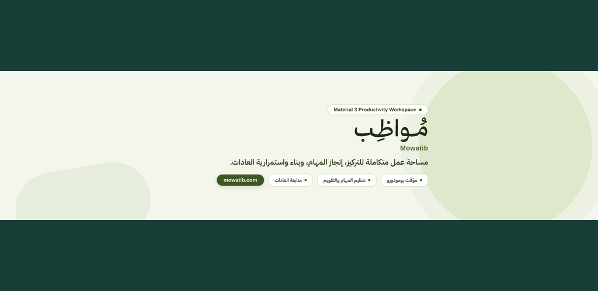
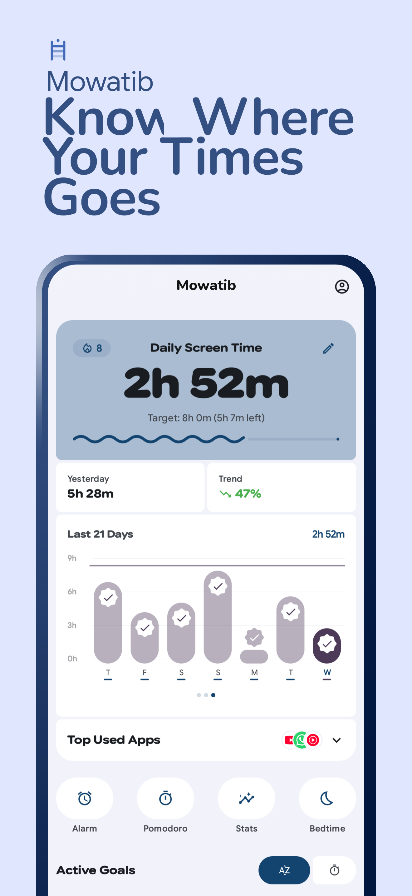
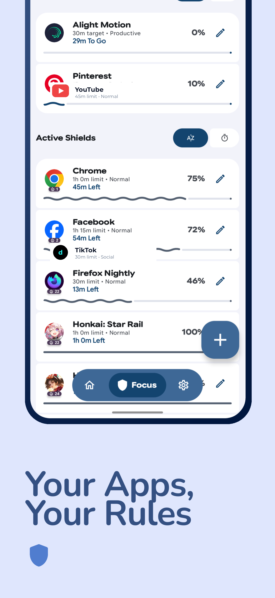
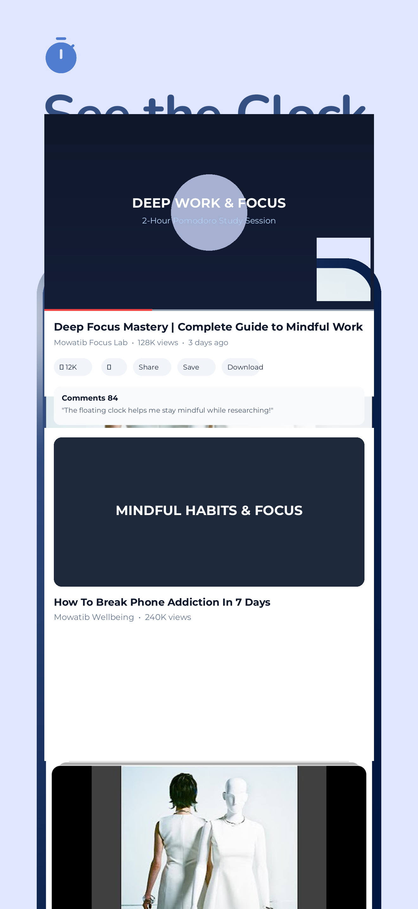
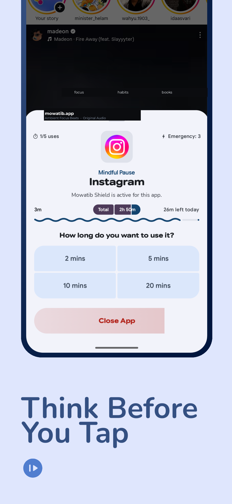
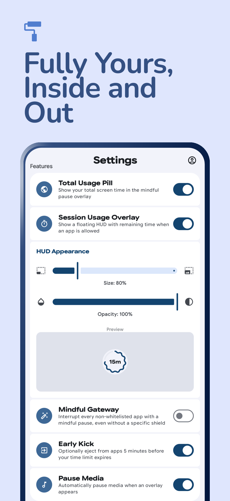
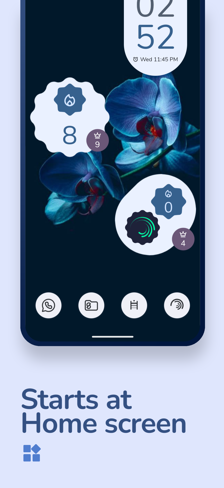

<p align="center">
  
</p>

<h1 align="center">Mowatib (مواظب)</h1>
<h3 align="center">A Material Design 3 Expressive Digital Wellbeing, Focus & Habit Platform for Android</h3>

<p align="center">
  
</p>

<p align="center">
  &nbsp;&nbsp;
  &nbsp;&nbsp;
  &nbsp;&nbsp;
  &nbsp;&nbsp;
  <a href="https://github.com/biZenX/Mowatib/releases/latest">
    
  </a>
</p>

<p align="center">
  <strong>Mowatib (مواظب)</strong> is an open-source, privacy-first digital wellbeing and habit-building assistant for Android, built with <strong>Material Design 3 Expressive</strong>. Through proactive friction, intelligent intervention shields, Telegram accountability bots, and comprehensive focus tools, Mowatib empowers you to break dopamine scrolling loops, cultivate deep focus, and maintain long-term personal discipline.
</p>

<p align="center">
  <a href="https://github.com/biZenX/Mowatib/releases/download/v2.1.0/Mowatib-v2.1.0.apk">
    
  </a>
  &nbsp;&nbsp;
  <a href="https://github.com/biZenX/Mowatib">
    
  </a>
</p>

---

## Screenshots

<div align="center">
  <table border="0" cellpadding="0" cellspacing="2" style="border-collapse: collapse;">
    <tr style="border: none;">
      <td width="32%" style="border: none; padding: 2px;"></td>
      <td width="32%" style="border: none; padding: 2px;"></td>
      <td width="32%" style="border: none; padding: 2px;"></td>
    </tr>
    <tr style="border: none;">
      <td width="32%" style="border: none; padding: 2px;"></td>
      <td width="32%" style="border: none; padding: 2px;"></td>
      <td width="32%" style="border: none; padding: 2px;"></td>
    </tr>
  </table>
</div>

---

## Key Features

### Telegram Bot Integration & Accountability Partner
- **Direct Telegram Link**: Connect Mowatib to your Telegram account via Chat ID or deep link to `@MowatibAppBot`.
- **Instant Connection Test**: Send a real-time verification message to Telegram with a single tap.
- **Accountability Alerts**: Automatically dispatch warning messages to Telegram when a protected app limit is reached or emergency recharge is used.
- **Daily Summaries & Recaps**: Receive evening recaps of screen time, completed tasks, and streak progress directly in your Telegram inbox.
- **Focus Milestones**: Real-time notifications upon completing Pomodoro sessions and maintaining habit streaks.
- **Custom Bot Support**: Configure your own bot token from `@BotFather` for self-hosted, private workflows.

### Material 3 Expressive Home Screen Widgets (7 Glance Widgets)
- **MowatibFocusWidget**: Glanceable streak indicator, active shield status, and quick launch.
- **MowatibPomodoroWidget**: Interactive timer controls (Start, Pause, Reset) directly from your launcher.
- **MowatibTasksWidget**: Interactive daily task checklist with instant toggle completion.
- **MowatibHabitsWidget**: Daily habit progression, streak tracking, and completion status.
- **MowatibMotivationalQuoteWidget**: Curated daily Arabic quotes on discipline, focus, and continuous growth.
- **MowatibQuickDashboardWidget**: At-a-glance dashboard displaying daily screen time, tasks done, and habit counters.
- **MowatibAmbientAudioWidget**: Quick play/pause control for focus soundscapes.

### App Shields & Proactive Intervention
- **Shield Mode**: Protect distracting applications with mindful delays, launch limits, and strict lockouts.
- **Delay App**: Introduce customizable friction timers (5s to 60s) before opening distracting apps to break muscle memory.
- **Mindful Gateway**: Intercept all non-whitelisted applications with a moment of mindfulness to deter compulsive opening.
- **Floating Session HUD**: Non-intrusive floating pill indicating remaining session allowance with adjustable opacity and position.
- **Emergency Quotas**: Configurable emergency recharge tokens for unexpected necessities without abandoning long-term limits.

### Habits, Tasks & Ambient Focus Engine
- **Smart Tasks System**: Integrated checklist supporting categories (Focus, Work, Study) and persistent storage.
- **Habit & Streak Tracker**: Daily habit ledger with automated midnight reset and streak preservation.
- **Ambient Focus Audio**: Built-in concentration soundscapes (Rainfall, White Noise, Nature) that play without requiring internet connectivity.

### Authentic Typography & Warm Aesthetics
- **Bundled Offline Fonts**: Fully integrated **IBM Plex Sans Arabic** (`Regular`, `Medium`, `SemiBold`, `Bold`) and **Thmanyah Sans** fonts.
- **Warm Creamy Palette**: Earthy, soothing color scheme (`#FDFBF7` cream light theme, `#1C1B18` dark theme, `#3D5622` organic olive accents) designed to reduce eye strain.
- **Pure Vector Drawables**: Zero dependency on platform emojis; all icons use crisp, scalable Material Vector SVGs.

### Pomodoro, Schedules & Mindful Detox
- **Pomodoro Timer**: Flexible focus/break intervals, session presets, and detailed historical statistics.
- **Smart Focus Schedules**: Block or allow apps based on recurring calendar days and time windows.
- **Bedtime Mode**: Automatically silence distracting notifications, wind down screen engagement, and encourage sleep.
- **Pause Point Challenges**: Mindful friction before opening apps—breathing exercises, math problems, typing drills, step counting, or NFC/QR code scans.
- **Eye Care (20-20-20)**: Periodic break reminders to prevent digital eye strain during extended work periods.
- **Lockdown Mode**: Restrict changes to your settings, shields, and goals during critical commitment windows.

---

## Application ID & Coexistence

Mowatib uses the unique application ID:
```
com.bizenx.mowatib
```
This ensures 100% side-by-side coexistence with any previously installed packages. You can install Mowatib safely without removing existing apps or encountering package collision errors.

---

## Installation Guide

### Download Pre-built APK
Download the latest signed release APK directly from GitHub:
**[Download Mowatib-v2.1.0.apk](https://github.com/biZenX/Mowatib/releases/download/v2.1.0/Mowatib-v2.1.0.apk)**

### Build from Source
1. Clone the repository:
   ```bash
   git clone https://github.com/biZenX/Mowatib.git
   cd Mowatib
   ```
2. Open the project in **Android Studio Ladybug (2024.2.1)** or newer.
3. Ensure **Android SDK 34** and **JDK 17** are configured.
4. Assemble the release build:
   ```bash
   ./gradlew assembleFullRelease
   ```
5. The generated APK will be located at:
   ```
   app/build/outputs/apk/full/release/Mowatib-full-2.1.0.apk
   ```

---

## Permissions & Privacy Transparency

Mowatib operates with a privacy-first architecture. All app statistics, habit histories, and usage data remain strictly on your local device.

### Required Permissions
1. **Usage Access (`PACKAGE_USAGE_STATS`)**: Required to measure screen time and enforce app time limits.
2. **Display Over Other Apps (`SYSTEM_ALERT_WINDOW`)**: Required to display mindful pauses, session HUDs, and shield screens.
3. **Query All Packages (`QUERY_ALL_PACKAGES`)**: Required to list installed applications so you can configure shields.
4. **Post Notifications (`POST_NOTIFICATIONS`)**: Required for goal updates, Pomodoro completion alerts, and daily recaps.
5. **Foreground Service (`FOREGROUND_SERVICE`)**: Ensures reliable background tracking without process termination.
6. **Boot Completed (`RECEIVE_BOOT_COMPLETED`)**: Restores alarms, bedtime schedules, and background monitoring after device reboot.

### Optional Permissions
- **Accessibility Service (`BIND_ACCESSIBILITY_SERVICE`)**: Provides instant app launch detection for immediate shield engagement.
- **Notification Listener (`BIND_NOTIFICATION_LISTENER_SERVICE`)**: Hides distracting notifications during active focus schedules.
- **Ignore Battery Optimizations**: Prevents Android from terminating background focus timers.
- **Exact Alarm (`SCHEDULE_EXACT_ALARM`)**: Ensures midnight habit resets and bedtime schedules trigger precisely.
- **Internet (`INTERNET`)**: Used exclusively for in-app update checks and optional Telegram Bot integration. No analytics or private telemetry are ever transmitted.
- **Camera / NFC (`CAMERA`, `NFC`)**: Only accessed if you explicitly configure QR code or NFC scan dismiss tasks in Pause Point.

---

## Author & Maintainer

- **[biZenX](https://github.com/biZenX)** — Maintainer & Lead Developer of Mowatib.

---

## License

This project is licensed under the **[GNU General Public License v3.0](LICENSE)**.
